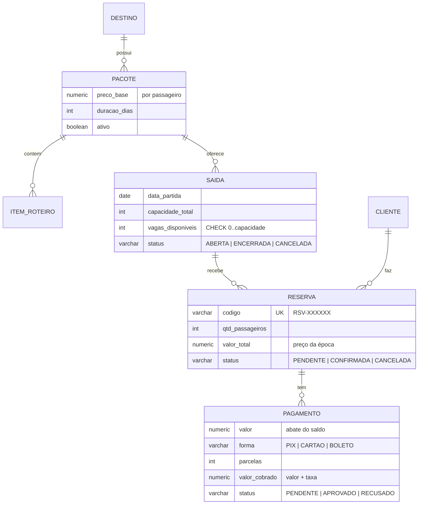

# API de Reservas para Agência de Turismo

[](https://github.com/heiitor06/api-reservas-turismo/actions/workflows/ci.yml)

API REST para vender pacotes turísticos: destinos, pacotes com roteiro, saídas com lotação, clientes,
reservas e pagamentos. O ponto central é **não vender a mesma vaga duas vezes** quando várias pessoas
reservam ao mesmo tempo, e provar isso com testes contra um Postgres de verdade.

**Stack:** Java 25 · Spring Boot 4.1 (Web MVC, Data JPA, Validation) · PostgreSQL 17 · Flyway ·
Springdoc OpenAPI · JUnit 5, Mockito, AssertJ, Testcontainers · Docker Compose

**Front-end:** [rumo-agencia-web](https://github.com/heiitor06/rumo-agencia-web), o site de uma agência fictícia
(Next.js 16) que consome esta API: vagas e preços ao vivo, cotação, reserva e pagamento em partes.

## Destaques

- **Controle de concorrência provado por teste.** 20 threads disputando 5 vagas: na versão sem lock, as 20
  conseguiram reservar; com lock pessimista, exatamente 5. O histórico de commits mostra o antes
  ([`db8c5d1`](https://github.com/heiitor06/api-reservas-turismo/commit/db8c5d1), teste vermelho) e o depois
  ([`211f311`](https://github.com/heiitor06/api-reservas-turismo/commit/211f311)). A análise completa, com as alternativas comparadas, está em
  [docs/concorrencia.md](docs/concorrencia.md).
- **Os mesmos bugs de corrida em outros lugares**, encontrados e cobertos: cancelamento duplo devolvendo vaga
  duas vezes, dois pagamentos passando do total, reserva 100% paga que não confirmava.
- **Regras no domínio, testadas sem banco:** `Saida.reservarVagas`, transições de `Reserva` e `Pagamento`,
  `CalculadoraPreco` com testes parametrizados.
- **Erros padronizados** em `application/problem+json` (RFC 9457), com `type` estável por problema.
- **O banco como rede de segurança:** `CHECK` de vagas, `UNIQUE` em CPF e em saída por data, e violação de
  `UNIQUE` em requisições simultâneas tratada como 409 (não 500).

## Como rodar

Pré-requisito: Docker.

```bash
docker compose up --build
```

- API: http://localhost:8080
- Swagger UI: http://localhost:8080/swagger-ui.html

Fluxo completo de exemplo (destino → pacote → saída → cliente → cotação → reserva → pagamento → aprovação):

```bash
./scripts/fluxo-completo.sh
```

No Windows, rode pelo Git Bash. O script usa um CPF fixo; para rodar de novo no mesmo banco, passe outro
(`CPF=111.444.777-35 ./scripts/fluxo-completo.sh`) ou recrie o banco com `docker compose down -v`.

### Desenvolvimento

Pré-requisitos: JDK 25 e Docker.

```bash
docker compose up -d postgres   # só o banco
./mvnw spring-boot:run          # API na porta 8080, migrations aplicadas pelo Flyway
```

### Testes

```bash
./mvnw test     # unitários (regras de domínio e preço), sem Docker
./mvnw verify   # + integração e concorrência (sobe um Postgres pelo Testcontainers)
```

## Modelo de dados



Modelo completo e decisões: [docs/superpowers/specs/2026-10-16-api-reservas-design.md](docs/superpowers/specs/2026-10-16-api-reservas-design.md).

## Regras de negócio

| Regra | Valor (configurável em `agencia.preco`) |
|---|---|
| Preço | `preco_base × passageiros`, gravado na reserva (mudar o pacote depois não altera reservas) |
| Desconto de grupo | 10% a partir de 6 passageiros |
| PIX e boleto | só à vista, sem taxa |
| Cartão | até 3x sem taxa; de 4x a 10x, +1,5% por parcela acima da 3ª |
| Arredondamento | `HALF_EVEN`, 2 casas, só no valor final |

- A vaga é ocupada na criação da reserva (`PENDENTE`) e devolvida no cancelamento.
- Uma reserva aceita vários pagamentos (ex.: sinal + saldo). Pagamento pendente ocupa saldo; recusado libera.
- Quando os pagamentos aprovados cobrem o total, a reserva vira `CONFIRMADA`.
- Não se reserva em saída encerrada, cancelada, de pacote inativo ou que já partiu ("hoje" no fuso de São Paulo).

## Endpoints

| Método | Rota | O que faz |
|---|---|---|
| `POST` `GET` | `/api/destinos` | cria, lista (paginado) |
| `GET` `PUT` | `/api/destinos/{id}` | detalha, atualiza |
| `POST` `GET` | `/api/pacotes` | cria, lista (filtros `destinoId`, `ativo`) |
| `GET` `PUT` | `/api/pacotes/{id}` | detalha com roteiro, atualiza |
| `POST` | `/api/pacotes/{id}/itens` | adiciona item ao roteiro |
| `DELETE` | `/api/pacotes/{id}/itens/{itemId}` | remove item |
| `POST` `GET` | `/api/pacotes/{id}/saidas` | cria saída, lista saídas do pacote |
| `GET` | `/api/saidas/{id}` | detalha (vagas, data de retorno) |
| `PATCH` | `/api/saidas/{id}/status` | abre, encerra ou cancela |
| `POST` `GET` | `/api/clientes` | cria, lista (CPF mascarado) |
| `GET` | `/api/clientes/{id}` | detalha |
| `POST` | `/api/cotacoes` | simula o preço sem reservar |
| `POST` | `/api/reservas` | reserva vagas |
| `GET` | `/api/reservas/{codigo}` | detalha, com pagamentos e saldo |
| `POST` | `/api/reservas/{codigo}/cancelamento` | cancela e devolve as vagas |
| `POST` | `/api/reservas/{codigo}/pagamentos` | registra pagamento |
| `GET` | `/api/pagamentos/{id}` | detalha pagamento |
| `POST` | `/api/pagamentos/{id}/aprovacao` | simula aprovação do gateway |
| `POST` | `/api/pagamentos/{id}/recusa` | simula recusa do gateway |

### Erros

```json
{
  "type": "https://api.agencia.local/problemas/vagas-insuficientes",
  "title": "Vagas insuficientes",
  "status": 409,
  "detail": "2 vaga(s) solicitada(s), 1 disponível(is)",
  "instance": "/api/reservas",
  "vagasDisponiveis": 1
}
```

| Status | `type` | Quando |
|---|---|---|
| 400 | `dados-invalidos` | validação (com lista `erros`), JSON malformado, parcelamento inválido |
| 404 | `recurso-nao-encontrado` | id ou código inexistente |
| 409 | `vagas-insuficientes` | não cabe na saída (com `vagasDisponiveis`) |
| 409 | `saldo-excedido` | pagamento maior que o saldo (com `saldo`) |
| 409 | `operacao-invalida` | saída fechada ou já partida, transição de status inválida |
| 409 | `recurso-duplicado` | CPF ou saída duplicados, inclusive em requisições simultâneas |
| 503 | `tente-novamente` | lock da saída ocupado por mais de 3 s (com `Retry-After`) |

## Estrutura

Pacotes por funcionalidade; em cada um, controller → service → repository, DTOs em `record` e mapeamento
manual (`XResponse.from(...)`).

```
src/main/java/dev/carlosheitor/agencia/
├── destino/  pacote/  saida/  cliente/
├── preco/          CalculadoraPreco, cotação
├── reserva/        reserva com lock na saída
├── pagamento/      pagamentos com lock na reserva
└── compartilhado/  erros (ProblemDetail), Clock, OpenAPI
src/main/resources/db/migration/   V1..V6 (Flyway)
src/test/java/.../support/         base de integração, limpeza do banco, relógio controlável
```

## Fora do escopo (próximos passos)

Autenticação (Spring Security + JWT) · expiração de reserva pendente · passageiros individuais ·
estorno de pagamento no cancelamento · preço por saída (temporada) · CI no GitHub Actions.
