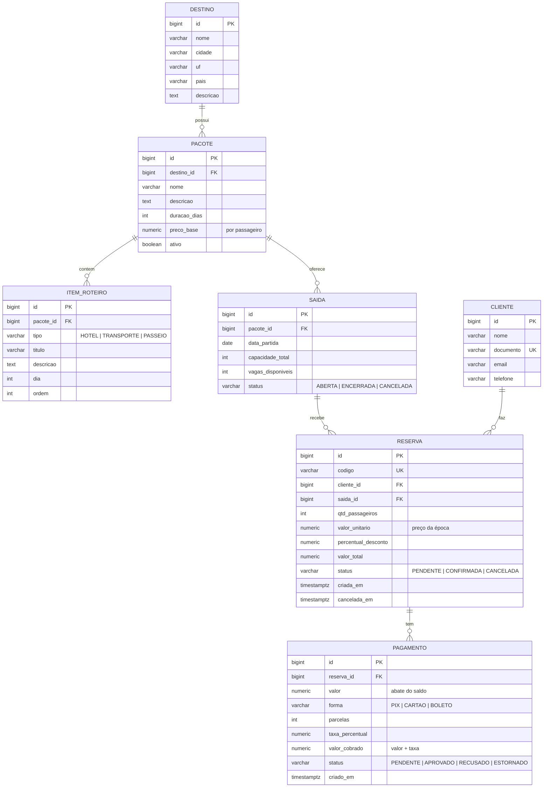

# API de Reservas para Agência de Turismo: Design

Data: 2026-10-16
Status: aguardando revisão do Carlos

## 1. Objetivo

API REST de portfólio para uma agência de turismo: catálogo de destinos e pacotes, saídas com controle de vagas, reservas e pagamentos. O foco técnico é **evitar overbooking sob concorrência** e provar isso com teste de integração contra um Postgres real. O código precisa ser explicável em entrevista: camadas simples, regras no domínio, decisões documentadas.

Critério de sucesso:
- Teste de concorrência com N threads disputando M vagas (N > M) passa de forma estável: exatamente M reservas e vagas = 0.
- `docker compose up` sobe a API e o banco; o Swagger UI fica acessível.
- Todas as regras de preço e de transição de status cobertas por teste unitário.

## 2. Stack

| Item | Escolha |
|---|---|
| Linguagem | Java 25 (LTS) |
| Framework | Spring Boot 4.1.x (4.1.1 é a estável no Initializr em 2026-10-16) |
| Módulos | Spring Web, Spring Data JPA, Validation |
| Banco | PostgreSQL + Flyway (`ddl-auto=validate`) |
| Documentação | Springdoc OpenAPI (Swagger UI) |
| Testes | JUnit 5, Mockito, AssertJ, Testcontainers (Postgres) |
| Build | Maven (wrapper incluído) |
| Infra | Dockerfile multi-stage + Docker Compose (app + postgres) |
| Depois | Spring Security + JWT |

Configurações fixas: `spring.jpa.open-in-view=false`, datas em `timestamptz` / `Instant` (UTC), dinheiro em `BigDecimal` com `NUMERIC(12,2)`.

## 3. Modelo de dados



Decisões:
- Reserva **não** guarda `pacote_id`: o pacote vem da saída (evita inconsistência).
- Reserva grava o **preço da época** (`valor_unitario`, `percentual_desconto`, `valor_total`). Mudança no `preco_base` não afeta reservas existentes.
- `data_retorno` não é gravada: `data_partida + duracao_dias - 1`, calculada no DTO.
- IDs `bigint` (identity) internos. A reserva é exposta pelo `codigo` (`RSV-` + 6 caracteres alfanuméricos aleatórios, maiúsculos, sem caracteres ambíguos).
- Enums como `varchar` + `CHECK`, não tipo `ENUM` do Postgres.

Constraints no banco:
- `saida`: `CHECK (vagas_disponiveis BETWEEN 0 AND capacidade_total)`, `CHECK (capacidade_total > 0)`, `UNIQUE (pacote_id, data_partida)`.
- `cliente`: `UNIQUE (documento)`. Documento guardado só com dígitos.
- `reserva`: `CHECK (qtd_passageiros > 0)`, `UNIQUE (codigo)`.
- `pacote`: `CHECK (preco_base > 0)`, `CHECK (duracao_dias > 0)`.
- `pagamento`: `CHECK (valor > 0)`, `CHECK (parcelas BETWEEN 1 AND 10)`.

## 4. Regras de negócio

### 4.1 Preço (configurável via `@ConfigurationProperties`, prefixo `agencia.preco`)

| Regra | Valor de exemplo |
|---|---|
| Subtotal | `preco_base × qtd_passageiros` |
| Desconto de grupo | a partir de **6** passageiros: **10%** sobre o subtotal |
| PIX e boleto | sempre 1x, sem taxa |
| Cartão 1x a 3x | sem taxa |
| Cartão 4x a 10x | **+1,5% por parcela acima da 3ª** sobre o valor do pagamento (6x = 4,5%; 10x = 10,5%) |

Arredondamento: 2 casas, `RoundingMode.HALF_EVEN`, aplicado só no resultado final de cada valor.
O desconto de grupo entra na reserva; a taxa de parcelamento entra no pagamento (`valor_cobrado = valor × (1 + taxa)`), e o saldo da reserva é abatido pelo `valor`, não pelo `valor_cobrado`.

### 4.2 Reserva
- Criar: saída `ABERTA`, pacote ativo, `data_partida` no futuro, `vagas_disponiveis >= qtd`. Debita as vagas na mesma transação. Status inicial `PENDENTE`.
- Transições válidas: `PENDENTE → CONFIRMADA`, `PENDENTE → CANCELADA`, `CONFIRMADA → CANCELADA`. Qualquer outra gera erro 409.
- Cancelar: devolve `qtd_passageiros` à saída e grava `cancelada_em`. O estorno dos pagamentos fica fora deste escopo.
- As regras de transição ficam em métodos da entidade (`reserva.confirmar()`, `reserva.cancelar()`), testáveis sem banco.

### 4.3 Pagamento
- Só em reserva `PENDENTE`.
- `valor <= saldo`, onde saldo = `valor_total − soma(valor dos pagamentos APROVADO e PENDENTE)`. Pagamento pendente "reserva" saldo, para não aceitar dois pagamentos que juntos passem do total.
- A aprovação ou recusa é **simulada** por endpoint (papel de webhook de gateway). Nenhuma integração real.
- Ao aprovar: se a soma dos `APROVADO` for igual a `valor_total`, a reserva vira `CONFIRMADA`.
- Só pagamento `PENDENTE` pode ser aprovado ou recusado. Aprovar pagamento de reserva já `CANCELADA` gera 409 (o pagamento continua `PENDENTE`).

### 4.4 Saída
- `vagas_disponiveis` começa igual a `capacidade_total`.
- Mudança de status pela API administrativa: `ABERTA ↔ ENCERRADA`, e qualquer uma `→ CANCELADA` (terminal). Cancelar uma saída com reservas ativas é recusado (409) neste escopo.

## 5. Concorrência

**Decisão: lock pessimista** (`@Lock(PESSIMISTIC_WRITE)`, ou seja `SELECT ... FOR UPDATE`) na linha da `saida`, em toda operação que mexe em vagas.

```
@Transactional
criarReserva:
  saida = saidaRepository.findByIdForUpdate(id)   // trava a linha
  saida.reservarVagas(qtd)                        // regra no domínio; lança VagasInsuficientesException
  calcula preço, cria reserva, salva
  commit → libera o lock
```

- Timeout do lock: hint `jakarta.persistence.lock.timeout = 3000` ms. Estourou: 503 com `Retry-After`.
- **Ordem fixa dos locks: Saída antes de Reserva.** Cancelar: lê a reserva sem lock para descobrir a saída, trava a saída, depois trava a reserva (`findByCodigoForUpdate`) e revalida o status.
- Registrar ou aprovar um pagamento trava a reserva (`findByIdForUpdate`), evitando dois pagamentos simultâneos estourando o saldo ou confirmando duas vezes.
- O `CHECK (vagas_disponiveis >= 0)` é a rede de segurança: mesmo um bug no código não grava vaga negativa.

Alternativas avaliadas:
- **Otimista (`@Version`)**: correto, mas, com disputa concentrada na mesma linha (última vaga), gera falhas em cascata e exige retentativa fora da transação. Reservado para o futuro, só para edição administrativa da saída.
- **Update condicional** (`UPDATE ... WHERE vagas >= :q`): mais rápido e sem retentativa, mas tira a regra do domínio, deixa o contexto do JPA desatualizado e devolve erro genérico. Fica documentado no README como alternativa.

Narrativa no Git: primeiro um commit com a versão ingênua e o teste de concorrência **falhando**; depois o commit com o lock e o teste passando.

## 6. Arquitetura

- **Pacote por funcionalidade**: `destino`, `pacote`, `saida`, `cliente`, `reserva`, `pagamento`, `preco`, `compartilhado` (erros, config).
- Em cada pacote: `XController`, `XService` (classe concreta, sem interface + impl), `XRepository`, entidade, `dto/` com `record`s.
- **Mapeamento manual**: `XResponse.from(entidade)` e métodos de fábrica. Sem MapStruct; o volume não justifica o processador de anotação.
- Controller só valida a entrada (`@Valid`) e delega; transação no service; regras de estado nas entidades; cálculo de preço em `CalculadoraPreco` (classe pura, sem Spring além das properties).
- Entidades não saem da camada de service: controller recebe e devolve DTO.

## 7. API (v1)

| Método | Rota | Descrição |
|---|---|---|
| POST, GET | `/api/destinos` | criar, listar |
| GET, PUT | `/api/destinos/{id}` | detalhar, atualizar |
| POST, GET | `/api/pacotes` | criar, listar (filtros `destinoId`, `ativo`; paginado) |
| GET, PUT | `/api/pacotes/{id}` | detalhar (com itens), atualizar |
| POST | `/api/pacotes/{id}/itens` | adicionar item ao roteiro |
| DELETE | `/api/pacotes/{id}/itens/{itemId}` | remover item |
| POST, GET | `/api/pacotes/{id}/saidas` | criar saída, listar saídas do pacote |
| GET | `/api/saidas/{id}` | detalhar (vagas, data de retorno) |
| PATCH | `/api/saidas/{id}/status` | mudar status |
| POST, GET | `/api/clientes` | criar, listar (paginado) |
| GET | `/api/clientes/{id}` | detalhar |
| POST | `/api/cotacoes` | simular preço (saída, qtd, forma, parcelas) sem reservar |
| POST | `/api/reservas` | criar reserva |
| GET | `/api/reservas/{codigo}` | detalhar (com pagamentos e saldo) |
| POST | `/api/reservas/{codigo}/cancelamento` | cancelar |
| POST | `/api/reservas/{codigo}/pagamentos` | registrar pagamento |
| POST | `/api/pagamentos/{id}/aprovacao` | simular aprovação |
| POST | `/api/pagamentos/{id}/recusa` | simular recusa |

## 8. Tratamento de erros

`@RestControllerAdvice` devolvendo `ProblemDetail` (RFC 9457), com `type` em `https://api.agencia.local/problemas/<slug>`.

| Situação | Status | slug |
|---|---|---|
| Bean Validation / JSON malformado | 400 | `dados-invalidos` (extensão `erros`: lista de campo + mensagem) |
| Recurso inexistente | 404 | `recurso-nao-encontrado` |
| Vagas insuficientes | 409 | `vagas-insuficientes` (extensão `vagasDisponiveis`) |
| Saída fechada, transição de status inválida | 409 | `operacao-invalida` |
| Documento duplicado, saída duplicada | 409 | `recurso-duplicado` |
| Pagamento acima do saldo | 409 | `saldo-excedido` |
| Timeout de lock | 503 | `tente-novamente` |
| Erro inesperado | 500 | `erro-interno` (sem stack trace na resposta; logado no servidor) |

Exceções de domínio herdam de `NegocioException` (status + slug), para o advice não virar uma lista enorme de `@ExceptionHandler`.

## 9. Testes

| Tipo | Escopo | Ferramenta |
|---|---|---|
| Unitário | `CalculadoraPreco` (parametrizado), `Saida.reservarVagas/devolverVagas`, transições da `Reserva` | JUnit 5 + AssertJ |
| Service | orquestração e erros (cliente inexistente, saída fechada etc.) | Mockito |
| Integração | repositories, migrations, constraints, fluxo HTTP + `ProblemDetail` | `@SpringBootTest` + Testcontainers (`@ServiceConnection`) + MockMvc |
| **Concorrência** | 20 threads × 5 vagas → 5 sucessos, 15 `VagasInsuficientes`, vagas = 0; reservas e cancelamentos misturados fecham o saldo; 2 aprovações simultâneas confirmam a reserva uma vez só | `ExecutorService` + `CountDownLatch`, testes **sem** `@Transactional`, limpeza do banco entre testes |

Container do Postgres reaproveitado entre classes de teste (singleton), para a suíte não ficar lenta.

## 10. Fora de escopo (etapas futuras)

- Spring Security + JWT (papéis ADMIN e CLIENTE)
- Expiração de reserva pendente com job agendado
- Passageiros individuais (tabela `passageiro`)
- Estorno de pagamento no cancelamento
- Preço por saída (temporada)
- `@Version` na edição administrativa de saída
- CI no GitHub Actions
